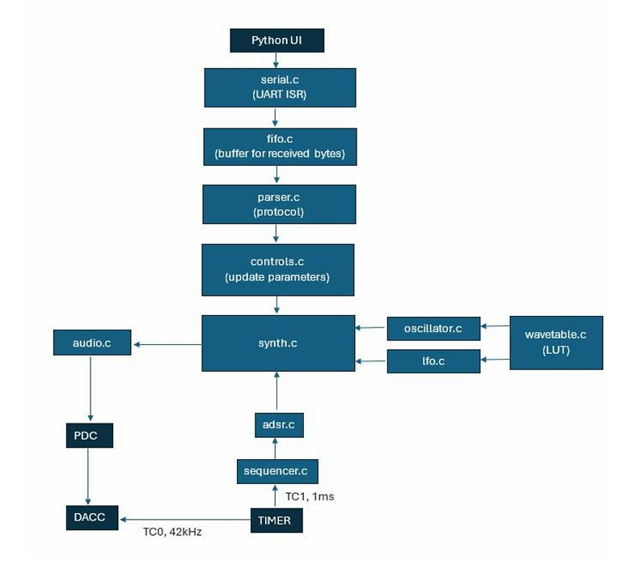
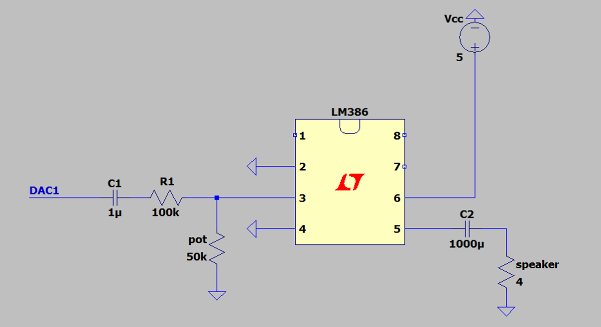
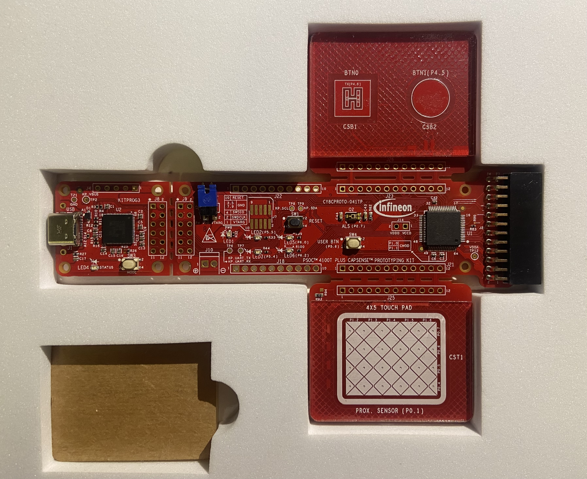

# Digital Sound Synthesizer on the SAM3X8E

A real-time digital synthesizer with a step sequencer, running on the Atmel SAM3X8E (Arduino Due). It uses additive and wavetable synthesis, ADSR envelopes and an amplitude LFO, and plays through the on-chip 12-bit DAC and an LM386 amplifier. You control it live from a Python GUI and an Infineon CapSense touch matrix.

## Features

- **ADDITIVE mode:** one voice built from 14 sine harmonics with adjustable amplitudes, you shape the timbre in real time through the touch matrix
- **WAVETABLE mode:** four independent voices using sine, sawtooth and square lookup tables
- Per-voice ADSR envelope and sequencer, plus a global amplitude LFO (tremolo)
- 42 kHz, 12-bit audio fed to the DAC by DMA, with about 3ms latency
- Python GUI over UART, CapSense touch control during playback
- A couple of demo songs

## Overview



Commands go from the Python UI over UART into a FIFO, then through a packet parser that updates the synth parameters. For audio, the main loop computes samples into a buffer, the PDC (DMA) moves them to the DAC on a 42 kHz timer trigger, and the LM386 drives the speaker. The CapSense board sends its touch events to the Python UI, which turns them into the same packets.

## Hardware

Arduino Due, LM386, 4Ω / 5W speaker, 1µF and 1000µF capacitors, 100kΩ resistor, 50kΩ potentiometer, MB102 power supply module, Infineon CY8CPROTO-041TP, and a PC for the UI.



DAC1 goes through a 1µF coupling capacitor (removes the ~1.65 V DC offset) and a 100kΩ resistor to LM386 pin 3. The 50kΩ pot forms a voltage divider that keeps the signal within the LM386's recommended input range and works as a volume control. Pins 2 and 4 go to ground, pin 6 to 5V, and pin 5 drives the speaker through the 1000µF capacitor.



The CY8CPROTO-041TP has two capacitive buttons and a touchpad. Its firmware was built in ModusToolbox from the stock UART and CapSense examples.

## How it works

- **Audio pipeline:** a timer on TC0 channel 0 triggers the DAC at 42 kHz. The PDC plays one 128-sample buffer while the CPU fills the other, and the DAC interrupt swaps them. Each buffer lasts about 3.05 ms. If the CPU misses the deadline, the previous buffer is replayed and a LED lights up.
- **Oscillator:** direct digital synthesis. A 32-bit phase accumulator is advanced by $M = f_{out} \cdot 2^{32} / f_s$ each sample, and its top 9 bits index a 512-entry lookup table. In ADDITIVE mode, harmonic phase increments are multiples of the fundamental's. At 42 kHz and a 1500 Hz top note, Nyquist limits this to 14 harmonics.
- **ADSR:** a state machine (`IDLE → ATTACK → DECAY → SUSTAIN → RELEASE`) in Q16.16 fixed point.
- **LFO:** same DDS principle, scales the mixed output of all voices. Depth 0 means no effect, maximum depth gives full tremolo. Only amplitude modulation is implemented for now.
- **Sequencer:** each voice has its own note table. A 1ms timer interrupt only counts time and sets a flag when the step ends, and the actual note change (new frequency, ADSR trigger) happens in the main loop, so the interrupt stays short.

## Control

Packets are 7 bytes, sent at most once per 10ms:

```
0xAA | MODULE | VOICE_ID | PARAMETER | INDEX | VALUE (16-bit, high byte and low byte)
```

- `MODULE`: `ENGINE`, `OSC`, `ADSR`, `SEQ`, `LFO` or `HARM`
- `VOICE_ID`: target voice, or `0xFF` for global parameters
- `INDEX`: element of a table (harmonic, sequencer step), `0` if unused

The UART runs at 115200 baud, 8N1. See `parser.c` and `controls.c` for the module and parameter IDs.

**CapSense controls:**

| Input | Action |
|---|---|
| Button 0 (`B0`) | Freeze the current touchpad value |
| Button 1 (`B1`) | Switch the selected sequencer on or off |
| Touchpad (`XY, <x>, <y>`) | ADDITIVE: X moves the emphasized region along the harmonics, Y sets its width. WAVETABLE: X sets LFO depth, Y sets LFO frequency |

## Repository contents

```
.
├── firmware/    # SAM3X8E firmware (C)
├── ui/          # Python GUI
├── capsense/    # ModusToolbox project for the CY8CPROTO-041TP
├── songs/       # Songs transcribed for the synth
├── images/      # Figures used in this README
└── README.md
```

## Songs

`songs/` has two transcriptions made just for fun: **"Olson"** by Boards of Canada and the **Tetris theme**, played in WAVETABLE mode with two voices.

## Measurements

| Sawtooth from 14 harmonics | Tone shaped by ADSR | Amplitude LFO on a sine |
|---|---|---|
|  |  |  |

## Future improvements

Digital filters, a reconstruction low-pass filter after the DAC, vibrato (LFO frequency modulation), an intermediate LUT for additive synthesis to cut CPU load, two-way UI communication, presets, sequence recording and MIDI input.

## References

Analog Devices MT-085 (DDS fundamentals), SAM3X/SAM3A datasheet (Atmel-11057), LM386 datasheet (Texas Instruments), CY8CPROTO-041TP user manual (Infineon).

## Author

Eva Kitrozoska, University of Ljubljana, 2026
